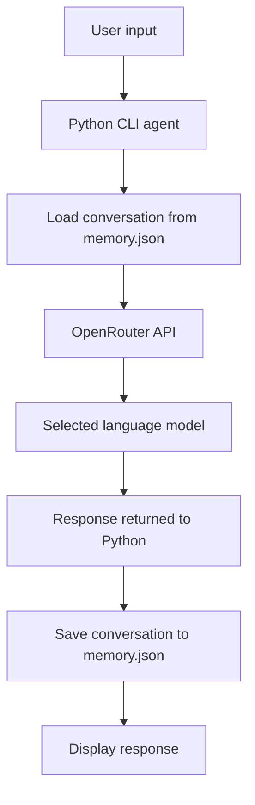

<div align="center">

# 🤖 AI Agent with Persistent Chat Memory

**A beginner-friendly Python project demonstrating LLM conversations and local, persistent JSON memory.**

[](https://www.python.org/)
[](https://openrouter.ai/)
[](https://www.json.org/)
[](LICENSE)

</div>

---

## 📌 Overview

This project is a command-line AI assistant built with Python. It sends user messages to a large language model (LLM) through OpenRouter and saves the conversation in a local `memory.json` file. When the program starts again, it loads that history and can use it as context for later questions.

It is a learning prototype—not a fully autonomous agent and not currently connected to a physical robot.

# Project visuals

Add real project visuals to this folder and link them from the root README.

Suggested files:
- `terminal-demo.png` — terminal showing a successful conversation (use fake, non-sensitive example text).
- `memory-file.png` — sanitized view of a sample `memory.json`.
- `architecture.png` — architecture diagram exported from your diagram tool.
- `demo.gif` — short screen recording converted to GIF.

Before publishing, hide API keys, account IDs, personal conversations, and other sensitive data. Do not present mockups as actual screenshots.


## ✨ Features

- **Natural-language chat:** ask questions in plain language.
- **Persistent conversation history:** load and save user/assistant messages in JSON.
- **Clear-memory command:** type `clear` to erase the saved chat.
- **Simple CLI:** run it from PowerShell or a terminal.
- **Configurable model:** choose a model with an environment variable.
- **Safer configuration:** keep API keys in a local `.env` file that Git ignores.
- **Basic error handling:** show configuration/API errors without crashing the conversation loop.

## 🧰 Technology stack

| Technology | Purpose |
|---|---|
| Python | Main application logic |
| OpenRouter | API gateway for supported LLMs |
| OpenAI Python SDK | Sends chat-completion requests using OpenRouter's compatible endpoint |
| JSON | Stores conversation history locally |
| python-dotenv | Loads local environment settings from `.env` |

## 🏗️ Architecture



### How a message is processed

1. The program loads earlier user and assistant messages from `memory.json`.
2. The user types a message.
3. Python sends the system prompt, conversation history, and new message to OpenRouter.
4. The selected LLM generates a response.
5. The program displays the response and saves the conversation locally.

## 📁 Project structure

```text
ai-agent-chat-memory/
├── agent.py              # Main command-line application
├── memory_store.py       # JSON load/save/clear helpers
├── memory.json           # Created locally at runtime; not committed
├── .env.example          # Safe configuration template
├── .gitignore             # Excludes secrets and local memory
├── requirements.txt       # Python dependencies
├── tests/
│   └── test_memory.py     # Unit tests for JSON memory
├── docs/
│   └── architecture.md    # Architecture and design notes
├── assets/
│   └── README.md           # Instructions for project screenshots
├── CONTRIBUTING.md        # Contribution guidance
└── LICENSE                # MIT license
```

## 🚀 Getting started (Windows)

### 1. Requirements

- Python 3.10 or newer
- Git (only needed to clone/publish the repository)
- An OpenRouter account and API key
- Internet connection

> API availability, free-model access, rate limits, and pricing can change. A free-model route is not a guarantee of unlimited free use.

### 2. Download the project

Clone your repository, or download the project ZIP from GitHub and extract it. Open the project folder in VS Code.

### 3. Create and activate a virtual environment

In the VS Code terminal (PowerShell):

```powershell
py -m venv .venv
.\.venv\Scripts\Activate.ps1
```

If PowerShell blocks activation, you can run the environment's Python directly instead:

```powershell
.\.venv\Scripts\python.exe -m pip install -r requirements.txt
```

### 4. Install dependencies

```powershell
python -m pip install --upgrade pip
python -m pip install -r requirements.txt
```

### 5. Configure the API key

Copy the example configuration:

```powershell
Copy-Item .env.example .env
notepad .env
```

Replace `replace_with_your_openrouter_api_key` with your own key. Save the file. **Never commit `.env`, publish your key, or paste it into screenshots.**

### 6. Run the agent

```powershell
python agent.py
```

Example session:

```text
MY AI AGENT WITH MEMORY
Commands: 'exit' to quit, 'clear' to erase chat memory.

You: My name is Alex.
Agent: Nice to meet you, Alex.

You: What name did I tell you?
Agent: You told me your name is Alex.
```

The response depends on the selected model and API availability; this example illustrates expected usage, not a verified test result.

## ⌨️ Commands

| Command | Action |
|---|---|
| `exit` | Ends the current session |
| `clear` | Erases saved conversation history |
| Any other text | Sends a message to the LLM |

## ⚙️ Configuration

Set these values in `.env`:

| Variable | Purpose | Default |
|---|---|---|
| `OPENROUTER_API_KEY` | Required API secret | None |
| `OPENROUTER_MODEL` | OpenRouter model identifier | `openrouter/free` |
| `MAX_TOKENS` | Maximum generated output tokens per reply | `300` |
| `MEMORY_FILE` | Path to the local conversation JSON file | `memory.json` |

You may replace `openrouter/free` with a model identifier currently available to your account on OpenRouter. Model names, provider availability, credit requirements, and limits can change.

## 🧪 Tests

The unit tests exercise the JSON memory helper without making API calls.

```powershell
python -m unittest discover -s tests -v
```

## 🔒 Privacy and security

- Keep API keys in `.env`; `.gitignore` excludes it.
- `memory.json` may contain personal conversation data and is excluded from Git.
- Do not store passwords, API keys, or other secrets in chat memory.
- Review files with `git status` before committing.
- If a key is accidentally published, revoke it immediately and create a replacement.

## ⚠️ Limitations

- The application requires internet access and a working OpenRouter API key.
- Free-model access, rate limits, and credit requirements depend on OpenRouter and the selected model.
- The entire conversation history is sent with each request. Long chats can increase token usage and exceed model context limits.
- JSON history is simple, but it is not a searchable long-term memory system.
- The agent can produce incorrect answers; verify important information.
- It has no built-in web search, document retrieval, autonomous planning, or physical robot control.
- It is a prototype, not a production-grade or safety-certified robotics system.

## 🛣️ Future improvements

- Add message trimming and conversation summarization.
- Add selective long-term memory using a database or vector store.
- Explore Retrieval-Augmented Generation (RAG).
- Add tools such as calculator, document search, or approved web search.
- Add automated tests for the agent's API-error handling.
- Explore integration with ROS 2 in a simulated environment, with explicit safety checks before any robot action.

## 🖼️ Screenshots and demo

See [`assets/README.md`](assets/README.md) for recommended screenshots and GIFs. Add only real screenshots of the project running. Hide API keys, account identifiers, and personal conversation content.

## 🤝 Contributing

Bug reports and focused improvements are welcome. See [`CONTRIBUTING.md`](CONTRIBUTING.md).

## 📄 License

Released under the [MIT License](LICENSE).

---

<div align="center">

**Built as a learning project in Python, LLM integration, and persistent memory.**

</div>
